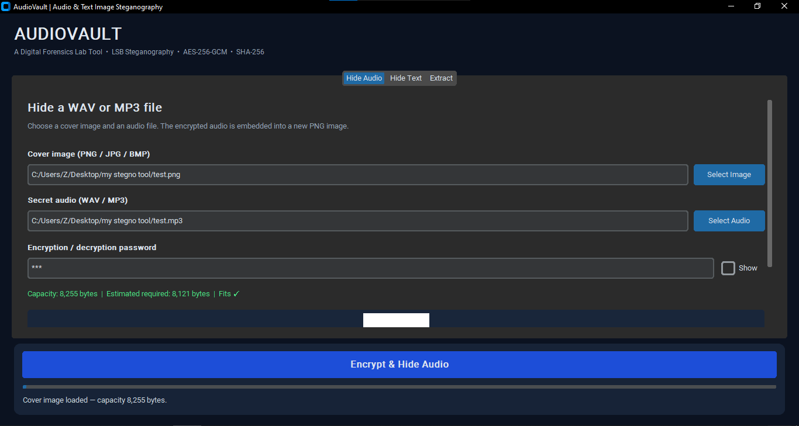
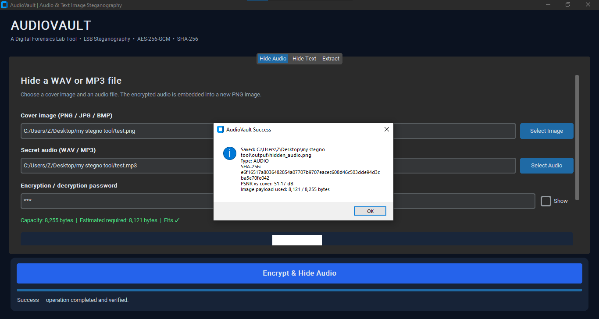
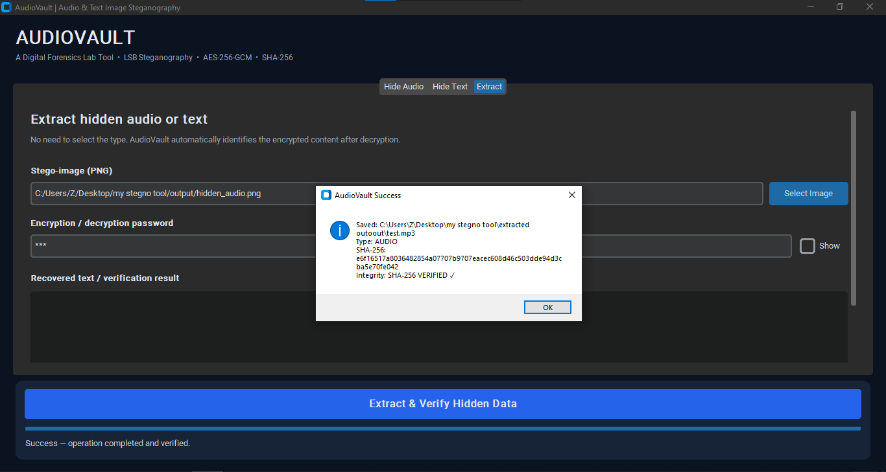
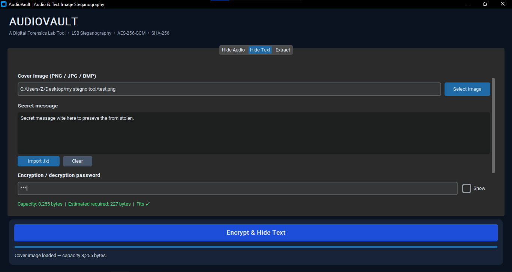
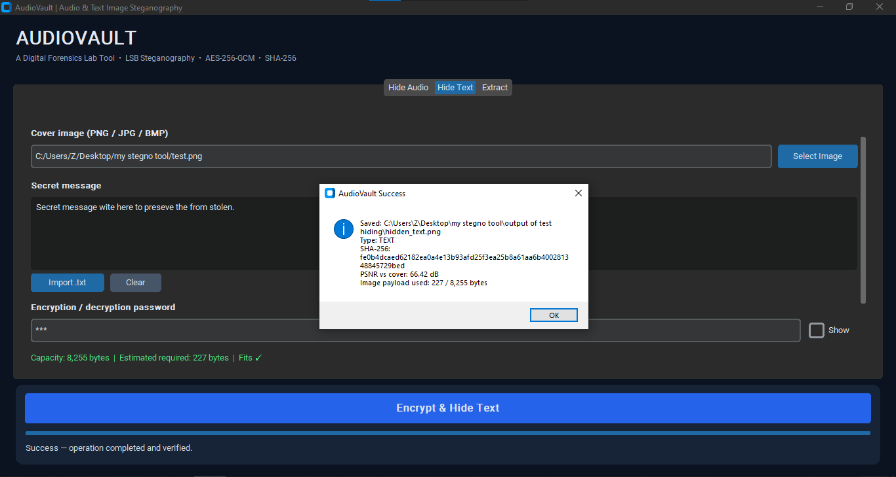
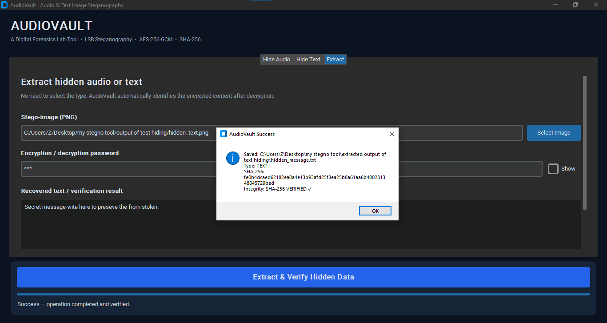

# AudioVault — Audio & Text Image Steganography

**An educational Python desktop application for hiding password-encrypted audio or text in PNG images, then recovering and verifying the original data.**

`Python 3.12+` · `CustomTkinter` · `Pillow` · `AES-256-GCM` · `Scrypt` · `SHA-256` · `RGB LSB Steganography`

> **Digital Forensics / Cybersecurity Lab Project** — Developed to demonstrate steganography, authenticated encryption, evidence integrity, file handling, and GUI-based testing. Use with files you own or are authorized to examine.



## Features

| Capability | Details |
|---|---|
| Hide audio | Embed a `.wav` or `.mp3` file inside a cover PNG, BMP, or JPEG image |
| Hide text | Enter a UTF-8 message or import a `.txt` file |
| Extract content | Automatically determine whether decrypted payload is audio or text |
| Password protection | Scrypt-derived 256-bit key and authenticated AES-256-GCM encryption |
| Data integrity | Verify the SHA-256 digest of the recovered bytes before saving |
| Capacity guardrails | Estimate payload size and reject images that cannot fit it |
| Quality feedback | Display PSNR to quantify cover-versus-stego image distortion |
| Data safety | Avoid overwriting original sources or existing extracted files |
| Desktop UI | Dark-themed CustomTkinter tabs with persistent action button |

## Quick start (Windows CMD)

Requirements: **Python 3.12 or later** and a standard Windows desktop environment.

```cmd
python -m venv venv
venv\Scripts\activate
python -m pip install -r requirements.txt
python make_demo_files.py
python main.py
```

The sample generator creates a synthetic audio tone, a test image, and a sample text file in `samples/`. Sample audio is not a human voice recording. You may instead select your own authorized WAV/MP3 file.

### Using the application

**Hide Audio**: Choose a cover image and WAV/MP3 file, enter a password, click **Encrypt & Hide Audio**, then save the generated `.png` file.

**Hide Text**: Choose a cover image, type a message or import `.txt`, enter a password, click **Encrypt & Hide Text**, and save the resulting `.png` file.

**Extract**: Select an AudioVault stego PNG, enter the same password, click **Extract & Verify Hidden Data**, and choose a new output folder. Audio is restored as WAV/MP3; text appears in the GUI and is saved to `hidden_message.txt`. The tool checks SHA-256 before writing recovered files.

> **Keep the output as PNG.** Cropping, resizing, pixel editing, or JPEG recompression can destroy the embedded data. Use long, unique passwords; short passwords are vulnerable to guessing.

## Screenshots — demonstrated workflows

### Audio hiding and recovery

| Input and capacity check | Encryption + hiding completed | Extraction + SHA-256 verification |
|:---:|:---:|:---:|
|  |  |  |

### Text hiding and recovery

| Text input and capacity check | Encryption + hiding completed | Extraction + SHA-256 verification |
|:---:|:---:|:---:|
|  |  |  |

[See the complete screenshot index and captions](docs/TESTING.md#screenshot-evidence).

## Results from the captured Windows GUI tests

These measurements come from the **user-provided demonstration screenshots**, not from a benchmark of all possible file sizes or images.

| Experiment | Payload used | Available capacity | PSNR (dB) | Demonstrated outcome |
|---|---:|---:|---:|---|
| MP3 hidden in PNG | 8,121 bytes | 8,255 bytes | 51.17 | Extracted MP3; SHA-256 **VERIFIED** |
| Text hidden in PNG | 227 bytes | 8,255 bytes | 66.42 | Extracted message; SHA-256 **VERIFIED** |

Both demonstrations show matching digests in the hide and extract success dialogs. The reported capacity and payload size are specific to these examples. This does not establish resistance to steganalysis or guarantee that every audio file can fit in every image.

## Automated tests

```cmd
python -m unittest discover -s tests -v
```

The current suite contains **10 passing tests**, including WAV and MP3 byte-for-byte round trips, Unicode text round trips, wrong-password and corrupt-payload handling, capacity, alpha-channel preservation, JPEG cover conversion, and overwrite protection. See [Testing and evidence](docs/TESTING.md) for the full checklist and distinction between automated tests and GUI demonstrations.

## How it works

```text
COVER IMAGE (PNG/JPG/BMP)       SECRET DATA (WAV/MP3/TEXT)
           \                         /
            \                       /
              Validate input / capacity
                        |
             SHA-256 + metadata
                        |
              Scrypt(password, salt)
                        |
              AES-256-GCM encrypt
                        |
          Embed bytes using sequential
               RGB-channel LSBs
                        |
                  STEGO PNG
                        |
              Read RGB LSB stream
                        |
              AES-GCM authenticate
                        |
                SHA-256 verify
                        |
            Original audio or text
```

The format is **AudioVault v2** (`AVLT02`). It is not compatible with older tutorial output (`AVLT01`). WAV/MP3 files are stored as original binary bytes; they are not transcoded. See [Architecture and security](docs/ARCHITECTURE.md).

## Project layout

```text
AudioVault-Steganography/
├── main.py                     # CustomTkinter desktop interface
├── steganography.py            # LSB encoding, decoding, capacity, PSNR
├── security.py                 # Scrypt, AES-GCM, SHA-256
├── make_demo_files.py          # Synthetic demonstration assets
├── requirements.txt
├── tests/
│   └── test_steganography.py   # Automated tests
├── samples/                    # Non-sensitive demonstration files
└── docs/
    ├── ARCHITECTURE.md
    ├── TESTING.md
    └── screenshots/
```

## Security limitations

- **Steganography is not undetectability.** This uses sequential spatial LSBs. Statistical analysis or comparison with the original image may reveal modifications.
- Encryption protects the payload's confidentiality and authenticity, but a **weak password may be attacked offline** if someone obtains the stego image.
- Lossy image processing, cropping, color conversion, and other edits can damage embedded data.
- Content size is limited by the image's pixel capacity. Processing very large files/images may consume significant RAM.
- SHA-256 confirms recovered content matches the original digest stored within the encrypted package; it does **not** establish evidence provenance or replace a chain-of-custody record.
- This is an educational tool and has **not** undergone a professional security audit.

## Inspiration and learning resources

- [OpenStego](https://github.com/syvaidya/openstego) — reference for the general steganography GUI workflow; AudioVault implements its own audio/text hiding workflow.
- [Pillow](https://pillow.readthedocs.io/) — image handling.
- [CustomTkinter](https://customtkinter.tomschimansky.com/) — graphical interface.
- [cryptography](https://cryptography.io/en/latest/) — authenticated encryption and key derivation primitives.

**Project category:** Digital Forensics · Cybersecurity · Python Desktop Application
