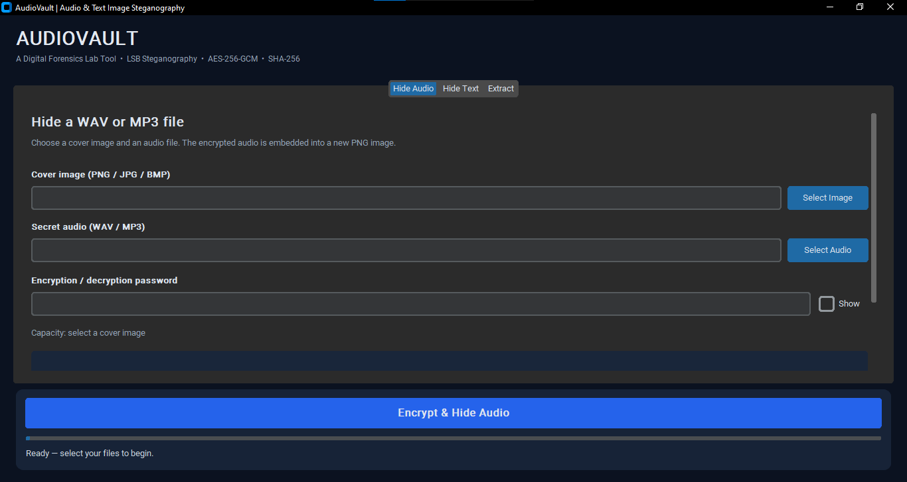
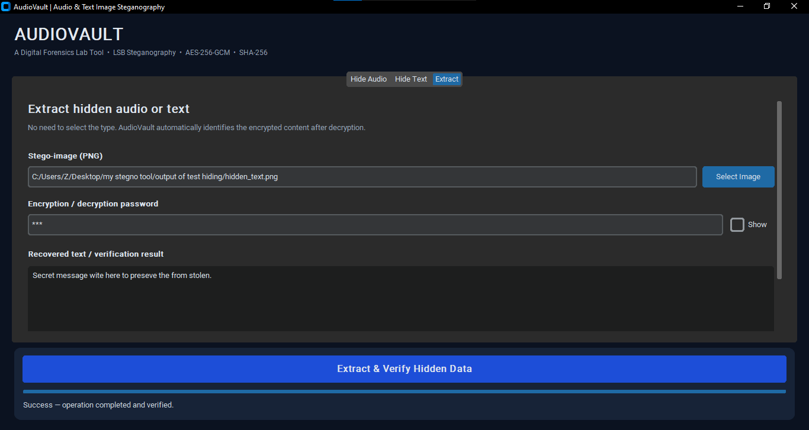

# Testing and screenshot evidence

This page distinguishes two sources of evidence: (1) **automated tests** of the Python implementation, and (2) **manual GUI demonstrations** shown in the screenshots supplied for the project.

## Run the automated tests

```cmd
venv\Scripts\activate
python -m unittest discover -s tests -v
```

Ten tests passed during the documentation preparation. For independently reproducible evidence, execute the command on your own computer and optionally add a terminal screenshot of the result.

### Automated test coverage

| Test case | Purpose |
|---|---|
| WAV round trip | Recover exact original audio bytes and correct SHA-256 |
| MP3 round trip | Confirm binary-preserving MP3 hide/extract behavior |
| Unicode text round trip | Restore multi-language UTF-8 text |
| Wrong password / damaged ciphertext | Ensure authentication failure is handled |
| Insufficient capacity / non-stego input | Reject unsupported, invalid or undersized content |
| Capacity estimate | Check payload accounting |
| RGBA preservation | Leave alpha channel unchanged |
| JPEG cover | Convert permitted JPEG cover to lossless PNG output |
| Overwrite protection | Do not overwrite extracted existing files |
| Source overwrite rejection | Do not replace the original cover image |

## GUI test evidence (from submitted screenshots)

### Audio case

- Selected a PNG cover and MP3 test file.
- GUI showed **8,255 bytes** of available capacity and **8,121 bytes** estimated required; the payload fit.
- After hiding, success dialog showed **PSNR 51.17 dB** and the digest of the original MP3.
- After extraction, the audio was saved as `test.mp3`, and the success dialog displayed **SHA-256 VERIFIED** with the same digest.

| Stage | Screenshot |
|---|---|
| Main window |  |
| Audio selected / capacity |  |
| Hidden audio saved |  |
| Audio recovered / verified |  |

### Text case

- A UTF-8 message was typed into the Hide Text tab.
- The GUI showed **8,255 bytes** available and **227 bytes** estimated required; the payload fit.
- Hide success dialog showed **PSNR 66.42 dB**.
- Extraction saved `hidden_message.txt`, displayed the recovered text, and reported **SHA-256 VERIFIED**.

| Stage | Screenshot |
|---|---|
| Message selected / capacity |  |
| Hidden text saved |  |
| Text recovered / verified |  |
| Extracted text displayed |  |

## Summary table

| Test | Image capacity | Payload used | PSNR | Result |
|---|---:|---:|---:|---|
| MP3 → image → MP3 | 8,255 bytes | 8,121 bytes | 51.17 dB | GUI reports SHA-256 verified |
| Text → image → text | 8,255 bytes | 227 bytes | 66.42 dB | GUI reports SHA-256 verified |

The provided screenshots support those two example workflows. They do not by themselves prove robustness across all image sizes, formats, or hostile transformations. The GUI test password is masked; no password is published in this documentation.

## Screenshot evidence

The source screenshots were supplied by the project author from a Windows desktop testing session. Selected images are retained without changing the application content. The names were made descriptive for documentation. The local Windows file paths visible in some images refer to that tester's own demonstration folders and are not required when running the application elsewhere.

## Suggested remaining quality checks

- Test incorrect passwords in the desktop GUI, and capture the resulting safe error dialog.
- Run `python -m unittest discover -s tests -v` on Windows and capture the terminal output.
- Try a larger MP3 with a cover that has enough capacity; document the capacity check and memory usage.
- Try preserving an image with an alpha channel.
- Keep screenshots free of personal data or sensitive source file contents before public release.
